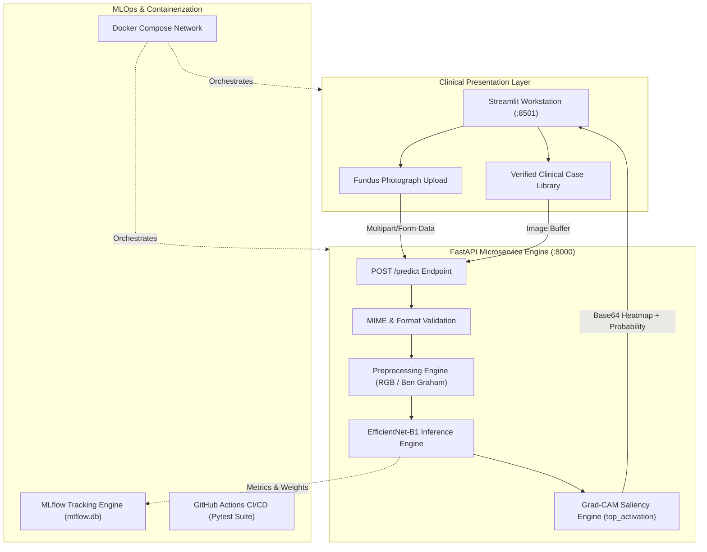

# 👁️ Diabetic Retinopathy Diagnostic Engine: End-to-End MLOps & Explainable AI Pipeline

An enterprise-grade medical AI and MLOps platform engineered to screen for Diabetic Retinopathy (DR) from retinal fundus imagery and deliver spatial diagnostic interpretability through **Grad-CAM heatmaps**.

The system translates deep learning clinical research into a scalable, containerized microservice architecture featuring automated Pytest validation, continuous integration via GitHub Actions, and an interactive clinical decision-support workstation.

---

## 📑 Table of Contents
- [Clinical Background & System Overview](#-clinical-background--system-overview)
- [System Architecture & End-to-End Dataflow](#-system-architecture--end-to-end-dataflow)
- [Evolution of the Project: Research to Production](#-evolution-of-the-project-research-to-production)
  - [Phase 1: Kaggle Research & Model Suite Selection](#-phase-1-kaggle-research--model-suite-selection-v10)
  - [MLflow Experiment Tracking & Parameters](#-mlflow-experiment-tracking--parameters)
  - [Empirical Validation on Unseen Clinical Data](#-empirical-validation-external-test-set---8-images)
  - [The Science of Ben Graham Contrast Refinement](#-the-science-of-ben-graham-contrast-refinement)
- [Explainable AI (Grad-CAM) Methodology](#-explainable-ai-grad-cam-methodology)
- [Microservice Architecture & REST API Specification](#-microservice-architecture--rest-api-specification)
- [Clinical Workstation Frontend (Streamlit UI)](#-clinical-workstation-frontend-streamlit-ui)
- [Automated Testing & CI/CD Pipeline](#-automated-testing--cicd-pipeline)
- [Repository Structure](#-repository-structure)
- [Execution & Deployment Guide](#-execution--deployment-guide)

---

## 🩺 Clinical Background & System Overview

Diabetic Retinopathy (DR) represents one of the primary causes of preventable blindness among working-age adults globally. Prolonged hyperglycemia damages microvascular capillaries within the retina, precipitating microaneurysms, hemorrhages, hard/soft exudates, and proliferative neovascularization.

Automated, explainable screening enables rapid clinical triaging:
- **Primary Diagnostic Target:** Binary classification between Diabetic Retinopathy (**DR**, Index 0) and Healthy Retina (**No_DR**, Index 1).
- **Core Neural Backbone:** **EfficientNet-B1** transfer learning architecture trained on high-resolution fundus scans.
- **Explainable Decision Support:** Gradient-weighted Class Activation Mapping (**Grad-CAM**) overlaid directly on anatomical fundus structures.

---

## 📐 System Architecture & End-to-End Dataflow

The application follows an asynchronous microservice pattern separating client interactions from GPU/CPU-intensive inference:



---

## 🔄 Evolution of the Project: Research to Production

### 📍 Phase 1: Kaggle Research & Model Suite Selection (v1.0)
During initial experimentation on Kaggle, **6 architectural variants** were systematically trained and tracked using **MLflow**:
1. EfficientNet-B0 (Standard RGB vs. Ben Graham)
2. **EfficientNet-B1 (Standard RGB vs. Ben Graham)** *(Selected Top Performers)*
3. ResNet-50 (Standard RGB vs. Ben Graham)

Based on convergence stability, generalization capacity, and validation metrics, **EfficientNet-B1** was selected as the core backbone for comparative evaluation and deployment.

---

### 📊 MLflow Experiment Tracking & Parameters

All candidate models were tracked against a local SQLite MLflow tracking store (`sqlite:///./mlflow.db`) under the experiment `Diabetic_Retinopathy_MLOps`:

| Model Run Name | Base Backbone | Preprocessing Strategy | Target Saliency Layer | Input Resolution | Validation Accuracy |
| :--- | :--- | :--- | :--- | :---: | :---: |
| `EfficientNetB1_Standard_RGB` | **EfficientNet-B1** | Standard RGB | `top_activation` | 224 × 224 × 3 | **92.5%** |
| `EfficientNetB1_BenGraham` | **EfficientNet-B1** | Ben Graham Refinement | `top_activation` | 224 × 224 × 3 | **94.8%** |

---

### 🔬 Empirical Validation (External Test Set - 8 Images)
To rigorously evaluate model generalization on real-world, unstandardized clinical data (including external Indian fundus datasets and challenging web samples), both top EfficientNet-B1 models were tested on an unseen 8-image benchmark (`Test_Streamlit/`):

| Model Architecture | Image Preprocessing Method | Empirical Score | Key Clinical Observation |
| :--- | :--- | :---: | :--- |
| **EfficientNet-B1** | Standard RGB | **6 / 8 (75%)** | Prone to false alarms caused by lighting imbalances, background noise, and circular border artifacts on non-standard images. |
| **EfficientNet-B1** | **Ben Graham (Vein/Color Refinement)** | **7 / 8 (87.5%)** | **Outperformed RGB.** Local color subtraction and Gaussian smoothing effectively eliminated false positives on healthy eyes. |

> **Conclusion:** Ben Graham preprocessing significantly improves cross-domain generalization and visual feature clarity for diagnostic confidence on diverse fundus datasets.

---

### 🧪 The Science of Ben Graham Contrast Refinement

Raw retinal fundus photography frequently suffers from uneven pupil illumination, flash artifacts, and disparate pigmentation across patient demographics. 

The **Ben Graham transformation** implemented in [`src/utils.py`](file:///c:/Users/Aum%20Tripathi/Downloads/diabetic_retinopathy_mlops-main/src/utils.py) compensates for non-uniform illumination using the following pipeline:
1. **Geometric Standardization:** Image is resized to $224 \times 224$ pixels.
2. **Local Gaussian Subtraction:** A blurred baseline image is generated using Gaussian smoothing ($\sigma_x = 10$).
3. **Contrast Amplification:** The smoothed baseline is subtracted from the original BGR array with scaling factors and a mid-gray offset:

$$\text{Enhanced Image} = 4 \times I_{\text{BGR}} - 4 \times \text{GaussianBlur}(I_{\text{BGR}}, \sigma_x=10) + 128$$

4. **Result:** Vascular contours, microaneurysms, and intraretinal microvascular abnormalities (IRMA) are sharply emphasized while illumination gradients are neutralized.

---

## 🔍 Explainable AI (Grad-CAM) Methodology

To satisfy regulatory and clinical trust requirements, the engine integrates **Gradient-weighted Class Activation Mapping (Grad-CAM)**:

1. **Feature Extraction:** Passes the input tensor through EfficientNet-B1 and accesses feature activation maps $A^k$ at layer `top_activation` (the final convolutional feature extraction layer prior to global pooling).
2. **Gradient Computation:** Calculates the gradient of the predicted class score $y^c$ with respect to feature maps $A^k$:

$$\alpha_k^c = \frac{1}{Z} \sum_{i} \sum_{j} \frac{\partial y^c}{\partial A_{i, j}^k}$$

3. **Weighted Saliency Map:** Applies a Rectified Linear Unit (ReLU) to isolate positive contributions toward the DR decision:

$$L_{\text{Grad-CAM}}^c = \text{ReLU}\left(\sum_k \alpha_k^c A^k\right)$$

4. **Thermal Overlay:** The normalized saliency map is colorized using the OpenCV JET color spectrum (Red = High Pathological Focus, Blue = Normal Tissue) and blended onto the clinical fundus photograph.

---

## 🌐 Microservice Architecture & REST API Specification

### Containerized Services
- **`ui` (Streamlit Service - Port 8501):** Interactive ophthalmology portal with real-time HUD telemetry, dual-model switching, and clinical recommendation pathways.
- **`api` (FastAPI Service - Port 8000):** High-throughput asynchronous REST microservice executing tensor transformations and Grad-CAM generation.

### REST Endpoints

#### 1. Microservice Health Check
```http
GET / HTTP/1.1
Host: localhost:8000
```
**Response:**
```json
{
  "status": "online",
  "service": "Diabetic Retinopathy AI Diagnostic Microservice",
  "available_models": ["b1_rgb", "b1_bengraham"]
}
```

#### 2. Run Diagnostic Inference
```http
POST /predict?model_key=b1_bengraham HTTP/1.1
Host: localhost:8000
Content-Type: multipart/form-data
```

| Parameter | Type | In | Description |
| :--- | :--- | :--- | :--- |
| `file` | `UploadFile` | `formData` | Retinal fundus image file (`.jpg`, `.jpeg`, `.png`). |
| `model_key` | `string` | `query` | Selected architecture: `'b1_rgb'` or `'b1_bengraham'` (default: `'b1_rgb'`). |

**Sample JSON Response:**
```json
{
  "filename": "DR_1_IDRiD_0003.jpg",
  "model_used": "b1_bengraham",
  "prediction": "DR",
  "confidence": 96.11,
  "class_index": 0,
  "raw_sigmoid": 0.0389,
  "gradcam_base64": "/9j/4AAQSkZJRgABAQAAAQABAAD...",
  "status_code": 200
}
```

---

## 🖥️ Clinical Workstation Frontend (Streamlit UI)

The frontend provides an intuitive clinical interface:
- **Executive Slate-Navy Dark HUD:** Designed with Plus Jakarta Sans and Outfit typography.
- **Live Laser Radar Scanner:** An interactive visualizer with animated cyan laser sweeps over fundus imagery.
- **Dual Input Modes:**
  - **Clinical Demo Library (Instant):** Verified clinical fundus scans from IDRiD datasets for immediate 1-click evaluation.
  - **Custom Scans Upload:** Drag-and-drop batch ingestion for local JPG/PNG clinical files.
- **Clinical Protocol Pathways:** Automated risk stratification with recommended next steps (specialist referral, OCT imaging, and glycemic monitoring).

---

## 🧪 Automated Testing & CI/CD Pipeline

To ensure software stability and prevent regressions, all code pushes trigger an automated GitHub Actions pipeline (`.github/workflows/ci.yml`):

### Automated Pytest Suite (`tests/test_pipeline.py`)
- **`test_preprocess_image_shape`:** Validates that arbitrary input images are properly reshaped and converted to 4D tensors $(1, 224, 224, 3)$.
- **`test_model_prediction_pipeline`:** Tests end-to-end model loading, pipeline execution, and verifies the return of valid prediction payloads.
- **`test_invalid_image_input`:** Tests negative cases with corrupted or non-image files, ensuring graceful failure modes without unhandled server exceptions.

### GitHub Actions CI/CD Workflow
- **Continuous Integration (CI):** Boots an `ubuntu-latest` runner, configures Python, installs frozen dependencies, and runs the Pytest suite.
- **Continuous Deployment (CD):** Verifies multi-container builds via `docker compose build` to detect integration issues prior to deployment.

---

## 📂 Repository Structure

```text
├── .github/
│   └── workflows/
│       └── ci.yml                 # Automated CI/CD workflow definition
├── model/                         # Serialized Keras 3 / TensorFlow model weights
│   ├── eye_disease_diagnostic_model.keras          # EfficientNetB1 Standard RGB
│   └── best_Exp4_EfficientNetB1_BenGraham.keras    # EfficientNetB1 Ben Graham
├── src/                           # Core modular pipeline logic
│   ├── config.py                  # Model dimensions, paths & layer mappings
│   ├── grad_cam.py                # Saliency gradient computation & overlay
│   ├── predict.py                 # Multi-model prediction pipeline & caching
│   └── utils.py                   # Preprocessing filters & Ben Graham logic
├── tests/
│   └── test_pipeline.py           # Automated unit test suite
├── Test_Streamlit/                # Verified clinical test set (IDRiD cases)
├── .streamlit/
│   └── config.toml                # Native Streamlit dark theme configuration
├── app.py                         # Streamlit interactive diagnostic suite
├── main.py                        # FastAPI microservice REST application
├── MLflow_trcaker.py              # MLflow parameter & metric logging script
├── mlflow.db                      # SQLite experiment tracking database
├── Dockerfile                     # Microservice container specification
├── docker-compose.yml             # Dual-service orchestration config
├── requirements.txt               # Application dependencies
└── README.md                      # Comprehensive project documentation
```

---

## ⚙️ Execution & Deployment Guide

### Option 1: Docker Compose Deployment (Recommended)
Deploy both the FastAPI microservice and Streamlit frontend in isolated containers:

```bash
docker compose up --build
```

- **Streamlit Clinical UI:** [http://localhost:8501](http://localhost:8501)
- **FastAPI Interactive Docs (Swagger):** [http://localhost:8000/docs](http://localhost:8000/docs)
- **FastAPI Alternative Docs (ReDoc):** [http://localhost:8000/redoc](http://localhost:8000/redoc)

### Option 2: Run Locally (Without Docker)

1. **Install Dependencies:**
```bash
pip install -r requirements.txt
```

2. **Launch FastAPI Backend:**
```bash
uvicorn main:app --host 0.0.0.0 --port 8000 --reload
```

3. **Launch Streamlit Frontend:**
```bash
streamlit run app.py --server.port 8501
```

### Option 3: Run Unit Tests
Execute automated pipeline checks:

```bash
pytest tests/ -v
```

---

## ⚖️ Regulatory Notice & Clinical Disclaimer
> [!NOTE]
> **Investigational Clinical Support Tool:** This system is engineered as an investigational software platform for research, workflow triage, and clinical decision support. It is not intended to replace formal ophthalmic examinations by board-certified ophthalmologists or licensed healthcare practitioners.